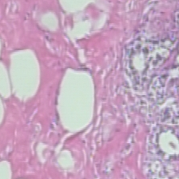
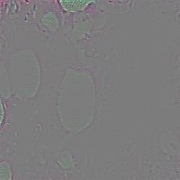
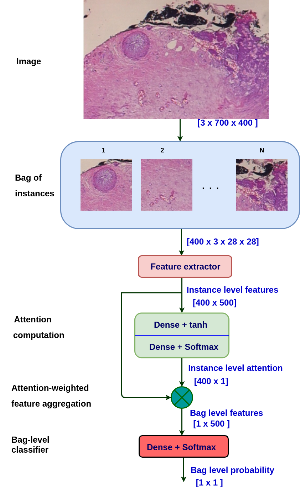
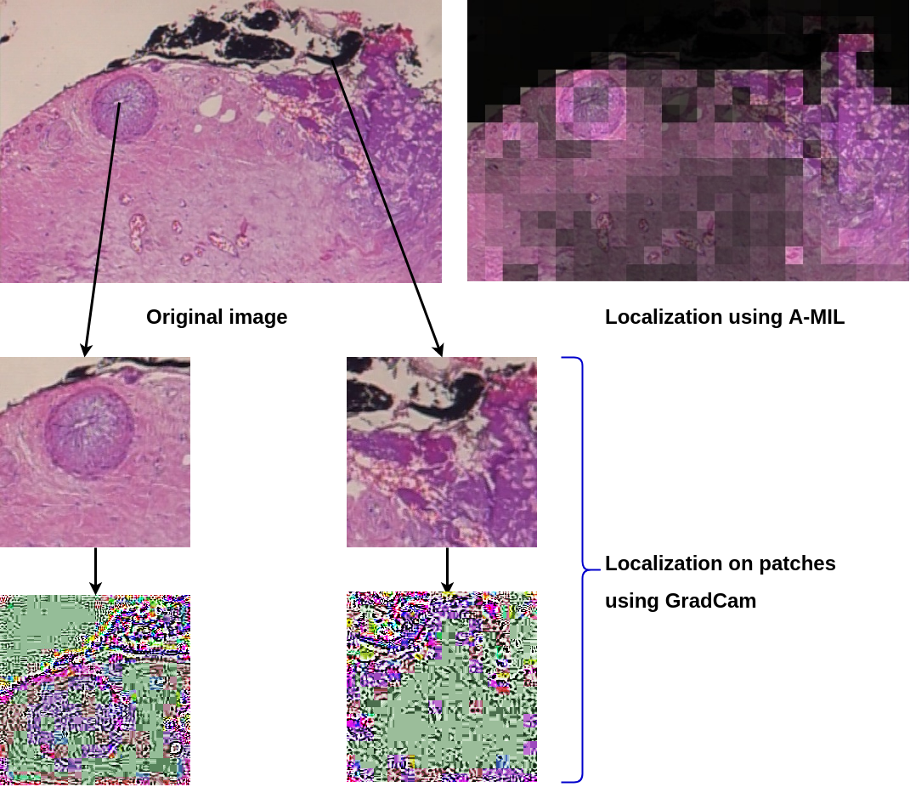
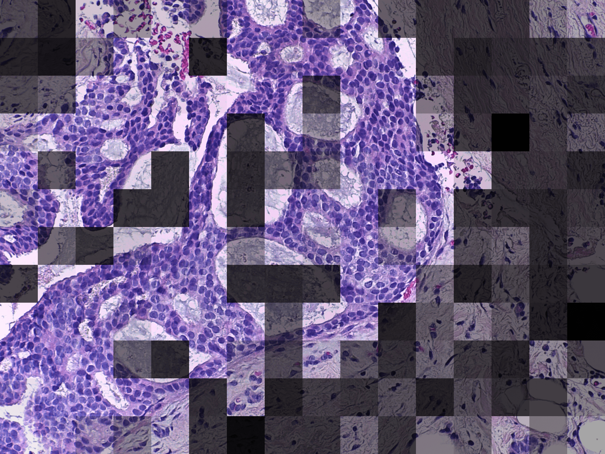

# Breast Cancer Histopathology Image Classification and Localization using Multiple Instance Learning

Official implementation of **"Breast Cancer Histopathology Image Classification and Localization using Multiple Instance Learning"**, published at **WIECON-ECE 2019**.

[](https://arxiv.org/abs/2003.00823)
[](https://ieeexplore.ieee.org/abstract/document/9019916)
[](LICENSE)

## Introduction

Deep learning in histopathology has attracted growing interest over the past decade thanks to its improvements on classification and localization tasks. Breast cancer is a prominent cause of death in women, and Computer-Aided Pathology is essential to analyze microscopic histopathology images for diagnosis given the increasing number of patients.

Convolutional neural networks give strong results in classifying cancer vs. non-cancer tissue images, but lack interpretability. In this work we frame image classification as a **weakly-supervised multiple instance learning (MIL)** problem and use **attention over instances (patches)** to localize tumour and normal regions — providing a better interpretation of the classification results. **Attention-based multiple instance learning (A-MIL)** is applied on the **BreakHis** and **BACH** datasets, and produces better localization without compromising classification accuracy.

## Grad-CAM and its limits on histopathology

Grad-CAM and Guided Grad-CAM are among the most popular methods for visualizing which regions a CNN uses for its prediction. Using the code in [`grad_cam/`](grad_cam), here is Guided Grad-CAM applied to a BreakHis patch:

<table>
  <tr>
    <td align="center"><b>Input patch</b><br></td>
    <td align="center"><b>Guided Grad-CAM</b><br></td>
  </tr>
</table>

On natural images Grad-CAM localizes objects cleanly, but on H&E histopathology the attribution is **diffuse and noisy** — it does not isolate the diagnostically-relevant glands. This motivates an attention-based approach.

## Attention-based Multiple Instance Learning (A-MIL)

We crop each image into small patches to form a **bag**, extract per-patch (instance) features with a CNN, compute an **attention weight** for each patch, and aggregate the patches into a bag-level feature for classification (Benign / Malignant / Invasive):

<p align="center"></p>

Multiplying each patch by its attention weight and stitching the patches back together reconstructs a localization map. A-MIL highlights the affected glands and ignores the background, while Grad-CAM on the same patches stays noisy:



The same method applied to the **BACH** dataset (bright = attended informative regions, dark = ignored background):



## Repository structure

| Path | Description |
|------|-------------|
| `my_network/` | Custom CNN architecture — `net.py` |
| `ResNet/` | Transfer learning with a pretrained ResNet — `resnet_pre.py` |
| `VGG/` | Transfer learning with a pretrained VGG — `vgg_pre.py` |
| `AMIL_codes/` | Attention-based MIL — model (`amil_model.py`), patch/bag loader (`patch_data.py`), train + test (`train_n_test.py`) |
| `grad_cam/` | Grad-CAM / Guided Grad-CAM visualization toolkit |
| `AMIL_Data/` | Expected data layout for A-MIL (`readme_data_format.txt`) |

## How to run the code

Each model folder trains on the chosen magnification (zoom) level and saves the model, terminal logs, TensorBoard logs and a run summary into the corresponding zoom-level folder.

- **Custom network:** `cd my_network && python net.py`
- **ResNet (pretrained):** `cd ResNet && python resnet_pre.py`
- **VGG (pretrained):** `cd VGG && python vgg_pre.py`
- **Attention MIL:** `cd AMIL_codes && python train_n_test.py` — trains A-MIL, tests it, and saves the patch-stitched visualizations.

Each folder also contains `run_for_all_zoom.sh`, which loops the corresponding script over all magnifications (40X, 100X, 200X, 400X):

```bash
bash run_for_all_zoom.sh
```

**Grad-CAM visualization:** put a test image in `grad_cam/inputs/`, set its filename in `grad_cam/src/misc_functions.py` (around line 253), then run `python grad_cam/src/guided_gradcam.py`. Results are written to `grad_cam/results/`.

## Dataset

**BreakHis** (used by the ResNet / VGG / custom-network models):

- Official source: [Breast Cancer Histopathological Database (BreakHis), UFPR](https://web.inf.ufpr.br/vri/databases/breast-cancer-histopathological-database-breakhis/)
- Also on Kaggle: [BreakHis dataset](https://www.kaggle.com/datasets/ambarish/breakhis)

**A-MIL data layout:** for attention-based MIL, re-arrange the dataset into the structure described in [`AMIL_Data/readme_data_format.txt`](AMIL_Data/readme_data_format.txt):

```
data_breakhis/
  40X/  100X/  200X/  400X/
    train/
      0/   (benign images)
      1/   (malignant images)
    test/
      0/   1/
```

## Requirements

> **Note:** this code was developed in 2019 on an older stack — **PyTorch 0.4.1, torchvision 0.2.1, TensorFlow 1.13.1** (see [`requirement.txt`](requirement.txt)). These pins no longer install on modern Python; to reproduce the original results, use a matching legacy environment (e.g. Python 3.6). Porting to a current PyTorch is straightforward but has not been re-validated here.

## Links

- [Article on Medium](https://medium.com/@dipeshtamboli/a-sota-method-for-visualization-of-histopathology-images-1cc6cc3b76f3)
- [arXiv:2003.00823](https://arxiv.org/abs/2003.00823) · [IEEE Xplore](https://ieeexplore.ieee.org/abstract/document/9019916) · [Harvard ADS](https://ui.adsabs.harvard.edu/abs/2020arXiv200300823P/abstract)

## Citation

```bibtex
@INPROCEEDINGS{9019916,
  author={Patil, Abhijeet and Tamboli, Dipesh and Meena, Sunil and Anand, Deepak and Sethi, Amit},
  booktitle={2019 IEEE International WIE Conference on Electrical and Computer Engineering (WIECON-ECE)},
  title={Breast Cancer Histopathology Image Classification and Localization using Multiple Instance Learning},
  year={2019},
  pages={1-4},
}
```

Plain text: A. Patil, D. Tamboli, S. Meena, D. Anand and A. Sethi, "Breast Cancer Histopathology Image Classification and Localization using Multiple Instance Learning," *2019 IEEE International WIE Conference on Electrical and Computer Engineering (WIECON-ECE)*, Bangalore, India, 2019, pp. 1-4.

## License

Released under the [MIT License](LICENSE).
